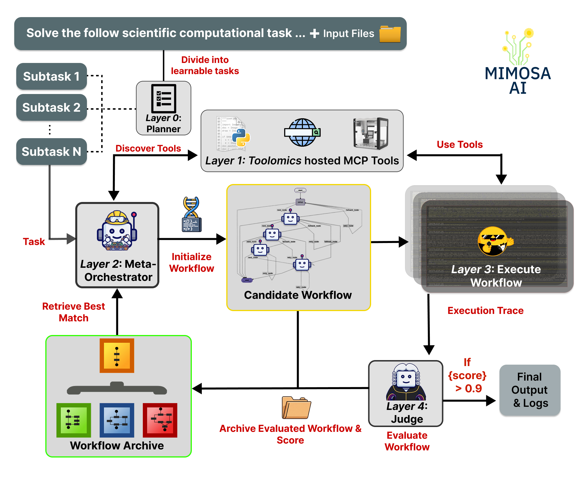

<div align="center">
<br>


</div>

<h1 align="center">Mimosa-AI — 自律的科学研究のための進化型マルチエージェントフレームワーク</h1>

<p align="center">
  <a href="./README.md">English</a> &nbsp;|&nbsp;
  <a href="./README.CHS.md">简体中文</a> &nbsp;|&nbsp;
  <a href="./README.CHT.md">繁體中文</a> &nbsp;|&nbsp;
  <a href="./README.JPN.md">日本語</a> &nbsp;|&nbsp;
  <a href="./README.KOR.md">한국어</a>
</p>

<p align="center">
    <em>自律的科学研究のための自己進化型マルチエージェントフレームワーク —— LLM 駆動のワークフロー合成、Quality-Diversity 進化探索、MCP ツール自動検出。</em>
</p>

<p align="center">
    <a href="https://arxiv.org/abs/2603.28986"></a>
    <a href="https://doi.org/10.48550/arXiv.2603.28986"></a>
    <a href="https://holobiomicslab.cnrs.fr/"></a>
</p>

<p align="center">
    <a href="https://github.com/HolobiomicsLab/Mimosa-AI/stargazers"></a>&nbsp;
    <a href="https://opensource.org/licenses/Apache-2.0"></a>
</p>

---


https://github.com/user-attachments/assets/744d2c34-4ac3-415c-bd8c-3454cd502271


---

## TL;DR

Mimosa-AI は **自律的科学研究のためのオープンソース Python フレームワーク** です。**タスクごとにカスタムのマルチエージェントワークフローを記述**し、サンドボックスで実行し、エージェントが実際に行った内容を独立した視点で検証し、**Quality-Diversity** に着想を得た探索によって世代を超えてワークフローを進化させ、そのタスクに最適なワークフローを見つけ出します。

ワークフローはプレーンな Python として出力されます — DSL なし、YAML なし — そのため、どの世代も検査・差分比較・単独での再実行が可能です。Policy/BT verifier は、各実行のワークスペース成果物を過去のすべての世代と比較します。必須の再現スクリプトが出力を再生成し、キャッシュされた単一の決定論的 Python 比較ポリシーが各ペアを判定し（目標に関連する画像が同点を解決することもあります）、蓄積されたペア判定は正則化 Bradley–Terry トーナメントに適合され、全世代の報酬が常に最新に保たれます。各世代は系譜とそのコードを生成した正確な LLM プロンプトと共にディスクに保存されます。

## 自動インストール

ターミナルで実行:

```bash
curl https://raw.githubusercontent.com/HolobiomicsLab/Mimosa-AI/refs/heads/mimosa_v2/auto-install.sh | bash
```

注意: これにより、関連プロジェクト `Toolomics` と `Perspicacité` も自動的にインストールされ起動します。

手動インストールは [手動インストール](##手動インストール) を参照してください。

---

## Web インターフェース

ブラウザで `http://localhost:5173/` を開くと、Web インターフェースにアクセスできます。

<p align="center">
  
</p>


---

## メタボロミクスにおけるデモ (V1)

このデモは V1 で実行されたものであり、近日中に更新されます。

<p align="center">
    <em>Mimosa-AI は <a href="https://www.researchgate.net/publication/323525305_Bioactivity-Based_Molecular_Networking_for_the_Discovery_of_Drug_Leads_in_Natural_Product_Bioassay-Guided_Fractionation">Nothias et al. (2018)</a> の LC-MS/MS 分子ネットワーキングパイプライン（<code>.mzML</code> ファイルでの特徴検出（MZmine / OpenMS / matchms 系のツールスタック — エージェントが自ら選択）、アラインメント、古典的な分子ネットワーキング（GNPS 形式のコサインクラスタリング））を、固定パイプラインなしの単一コマンドから自律的に再生成しました。</em>
</p>

https://github.com/user-attachments/assets/dcd04ade-9c43-44a8-b3e3-a999d3dc895d

再現されたネットワークは、論文で報告されたクラスタレベルのトポロジーと一致し、Cytoscape で読み込み可能な `.graphml` ファイルと、それに対応する特徴量定量テーブルとして出力されます。スコープに関する注記: ここで再現されるのは **分子ネットワーキング** のステージのみです。元の研究における生物活性ガイド分画、手動アノテーションレビュー、ライブラリマッチング（GNPS / SIRIUS / CSI:FingerID）は自律実行の対象外です。

<p align="center">
  
</p>

---


## 仕組み

5 つのレイヤーが小さな dataclass スキーマで配線されています。詳細は [`docs/concepts/architecture.md`](./docs/concepts/architecture.md) を参照してください。

<p align="center">
  
</p>

| レイヤー | コンポーネント | 役割 |
|-------|-----------|--------------|
| 0 | **Planner** *(任意、`--goal` のみ)* | 高レベルの目標を離散的なタスクに分解します。 |
| 1 | **ToolManager + Perspicacité** | 設定されたアドレス/ポート範囲で MCP ツールを検出し、必要に応じて文献スニペットを取得します。 |
| 2 | **EvolutionEngine** | ワークフローを合成し、世代を超えて進化させます（後述）。 |
| 3 | **WorkflowRunner** | 合成された Python ワークフローを Hugging Face [SmolAgents](https://github.com/huggingface/smolagents)（`LocalPythonExecutor` と AST 許可リスト方式）のサンドボックスで実行し、LangGraph の状態を共有します。 |
| 4 | **PolicyBTVerifierEvaluator** | Policy/BT verifier：再現ゲート → LLM 偵察とスキーマアダプタ → キャッシュ済みの単一決定論的比較ポリシー（視覚による同点決定）→ 正則化 Bradley–Terry 報酬。次の変異を駆動します。 |

### 進化ループ — 実際に進化しているもの

ワークフローは **完全な Python プログラム** であり、ソースコードとして変異されます。**コードを遺伝子型として扱う方式 (code-as-genotype)** で、遺伝子型はワークフローファイル、表現型はそれがワークスペース上に生成するものです。

- **選択: Quality-Diversity アーカイブ** — **非構造アーカイブ**（離散グリッドではなくフラットリスト）。最大集団サイズ 20、単一のスカラ化スコア `qd_score = (1−w)·quality + w·novelty`（`w = novelty_weight = 0.25`）で評価し、満杯時は最低 `qd_score` のメンバーを退去させます。**新規性探索 (novelty search)** は **ゲノタイプ埋め込み (genotype embedding)** の行動記述子 — ワークフローの生成ソースコードを L2 正規化した埋め込み（既定はローカルの `all-MiniLM-L6-v2`、オプションで OpenAI `text-embedding-3-small`）— 上のコサイン距離 k-NN（`k=15`）で測られます。親は子の数の逆数によるルーレット選択で抽出され、アーカイブを拡散させます（`MAX_CHILDREN_PER_PARENT = 8`）。
- **交叉** — デフォルトで約 40% の世代が 2 つの親を（強いもの優先で）組み合わせ、子のエージェント数は最も多い親の数でハードキャップされます。
- **コールドスタート** — アーカイブが空の場合、ディスク上の過去実行を類似度フィルタ（MiniLM コサイン ≥ 0.8）でスキャンして探索を播種します。有用なワークフローはタスク間で転移します。

詳細な仕組み: [`docs/concepts/evolution-engine.md`](./docs/concepts/evolution-engine.md)。

### verifier — スコアが実際に意味するもの

各実行後、**Policy/BT verifier**（`sources/evaluators/policy_bt_verifier/`、`verifier_kind = "policy_bt"`）がワークスペースを評価します：

1. **再現契約** — 各世代は出力を再生成するシェルスクリプト（依存関係のインストールを含む）を必ず提供しなければなりません。スクリプトが欠落または無効な世代は不適格となり、報酬は 0、フィードバックに必要な修正が示されます。既定で有効な再実行では、verifier が所有するコピー上で、API キーのない新しい venv 内でスクリプトを再実行します（既存の出力は事前に退避）。
2. **偵察とアダプタ** — 1 回の LLM 偵察が成果物を棚卸しし、目標だけから比較基準とそのステージ順を固定します。スキーマごとのアダプタが各ワークスペースを共通表現に正規化します（不明は `null`。偽の敗北に置き換えません）。
3. **ペアワイズ比較ポリシー** — キャッシュされた単一の決定論的 Python ポリシーが制限付きインタプリタで各ペアを比較し、逆順・自己比較・決定論性の検査を行います。最も早い決定的基準ステージが勝ちます。同点のとき、両側に目標に関連する画像があれば視覚モデルが裁きます。両方の提示順序が一致する場合のみ採用し、そうでなければ同点のままです。
4. **Bradley–Terry 報酬** — すべてのペア判定がタスクセッション全体の正則化 Bradley–Terry フィットに入り、報酬は中立強度の相手に勝つ現在の確率です。**評価のたびに全世代の評価値が更新されます。**最初の適格世代は 0.5 から始まります。

mutator は**証拠に基づくテキスト勾配**に導かれます — 敗北を先頭に、この世代が最も早く後れを取ったステージ順に並べ、実測の証拠を添え、スコアやポリシーコードは含みません。以前のハイブリッド時系列ラダー方式（`verifier_kind = "hybrid"`）と非推奨のマルチソース・クレーム単位 verifier（`"legacy"`）も選択できますが、実行の既定は `policy_bt` です。

完全なパイプライン: [`docs/concepts/evaluation-pipeline.md`](./docs/concepts/evaluation-pipeline.md)。

## ベンチマーク (V1)

**ScienceAgentBench**（102 タスク、`task` モード — 計画レイヤをバイパスしてワークフロー合成と改良を単独で評価）で評価しました:

| モード                                  | 成功率       | CBS | タスクあたりコスト |
| --------------------------------------- | ------------ | --------- | ----------- |
| DeepSeek-V3.2 single-agent              | 38.2 %       | 0.898     | $0.05       |
| DeepSeek-V3.2 one-shot multi-agent      | 32.4 %       | 0.794     | $0.38       |
| **DeepSeek-V3.2 iterative-learning**    | **43.1 %**   | **0.921** | **$1.70**   |

> **ScienceAgentBench における DeepSeek-V3.2 反復学習で 43.1% の成功率 — シングルエージェントベースラインに対して +4.9 ポイント、タスクあたりコスト $1.70。**

> ScienceAgentBench 上で DeepSeek-V3.2 を用いた場合、反復学習は GPT-4o を改善しますが、Claude Haiku 4.5 では僅かな劣化をもたらします。モデル依存の挙動については[論文](https://arxiv.org/abs/2603.28986)で分析しています。PaperBench の結果は [`docs/papers_bench_evaluation.md`](./docs/papers_bench_evaluation.md) を参照してください。

## ベンチマーク (V2)

**現在評価中**

---

## 手動インストール

### 1. MCP ツールの公開

Mimosa は設定のアドレス/ポート範囲（デフォルト `0.0.0.0:5000–5100`）で到達可能な任意の MCP サーバを検出します。

- **最も簡単な方法:** 関連プラットフォーム **[Toolomics](https://github.com/HolobiomicsLab/toolomics)** をインストールしてください — ワークスペースごとに 1 つの MCP shell サンドボックスを提供し、エージェントが必要に応じて科学パッケージをインストールできます。さらに、一般的な科学ツールスタックを公開するビルド済み MCP サーバ、共有ワークスペース管理、新しい MCP の簡単な登録フローも提供します。
- **持ち込み方式:** `discovery_addresses` を任意の到達可能な MCP サーバに向けてください — `fastmcp` スクリプト、ToolHive、サードパーティ MCP コンテナなど。Toolomics は必須ではありません。詳細は [`docs/concepts/tools-and-mcp.md`](./docs/concepts/tools-and-mcp.md#operating-without-toolomics) を参照してください。

### 2. Mimosa のインストール

```bash
pip install uv
git clone https://github.com/HolobiomicsLab/Mimosa-AI.git
cd Mimosa-AI
uv sync
# その後、以下で実行:
uv run main.py
```

**またはスタンドアロンの `mimosa` コマンドとしてインストール**（任意のディレクトリから使用可能）:

```bash
uv tool install git+https://github.com/HolobiomicsLab/Mimosa-AI.git   # または: uv tool install /path/to/Mimosa-AI
mimosa
```

この方法でインストールした場合、設定は `~/.config/mimosa/config.json` に保存され（オンボーディングウィザードによって書き込まれ、毎回の実行で自動的に読み込まれます）、API キーは `~/.config/mimosa/.env` に、実行時状態（メモリ、ワークフロー、実行カプセル）は `~/.local/share/mimosa/` に保存されます。リポジトリチェックアウトでは従来のレイアウト（`config_default.json` と状態ディレクトリがチェックアウト内部）が維持されます。

完全なクイックスタート: [`docs/getting-started/quickstart.md`](./docs/getting-started/quickstart.md)。

### 3. （任意）Perspicacité による科学的グラウンディング

[Perspicacité](https://github.com/HolobiomicsLab/Perspicacite-AI) はワークフロー合成とソース A のクレームを文献にグラウンディングします。実行中であれば、Mimosa は自動的に認識します。

```bash
git clone https://github.com/HolobiomicsLab/Perspicacite-AI.git && cd Perspicacite-AI
export DEEPSEEK_API_KEY="xxxxx" # API キーをエクスポート; anthropic と openrouter もサポート
uv run perspicacite -c config.yml serve
```

---

## Web インターフェース (Observatory)

Mimosa 自体は CLI のみですが、**Observatory** はオプションのローカル Web UI（FastAPI + React）で、あるランが生み出したもの — 系統樹、リプレイ、ワークスペース、セットアップ/起動フロー — を可視化し、ログを読む代わりに進化の様子を直接観察・検査できるようにします。これはシングルオペレーター向けのローカルホスト専用ツールで、認証機能はありません。共有ネットワークや公開ネットワークに公開しないでください。

```bash
cd webui && ./deploy.sh    # deps をインストールし、バックエンド + フロントエンドを実行; http://localhost:5173 を開く
```

詳細、環境変数、および API の全体像: [`webui/README.md`](./webui/README.md)。

---

## 監査証跡と再生

参照: [`docs/usage/transparency.md`](./docs/usage/transparency.md)、[`docs/usage/workspace.md`](./docs/usage/workspace.md)。

---

## 設定

参照: [`docs/reference/configuration.md`](./docs/reference/configuration.md)。

---

## 評価

各ベンチマークのセットアップ詳細: [`docs/science_agent_bench_evaluation.md`](./docs/science_agent_bench_evaluation.md)、[`docs/papers_bench_evaluation.md`](./docs/papers_bench_evaluation.md)。

---

## 通知とテレメトリ

- **Pushover** — スマートフォンへのリアルタイム進捗通知。`PUSHOVER_USER` と `PUSHOVER_TOKEN` を設定します。詳細: [`docs/usage/notifications.md`](./docs/usage/notifications.md)。
- **Langfuse** — すべての LLM 呼び出しのスパンレベルトレース。Langfuse リポジトリで `docker compose up -d` を実行し、`LANGFUSE_PUBLIC_KEY` / `LANGFUSE_PRIVATE_KEY` を `.env` に追加します。ダッシュボードは `http://localhost:3000`。詳細: [`docs/usage/telemetry.md`](./docs/usage/telemetry.md)。

---

## 関連研究

Mimosa-AI は LLM 駆動のプログラム探索と自律研究システムの、小規模ながら活発な系譜に位置しています。これらのいずれかを包含すると主張するわけではありません。それぞれが異なる問いに答えています:

| プロジェクト | 内容 | Mimosa との相違点 |
|---------|--------------|--------------------|
| [Sakana AI Scientist](https://github.com/SakanaAI/AI-Scientist) | ML におけるエンドツーエンドの論文生成 | Mimosa は **タスクごとのワークフロー合成** を QD + verifier で最適化するもので、論文全体の生成ではありません |
| [DiscoPOP](https://github.com/SakanaAI/DiscoPOP)（Lange et al. 2024） | LLM 駆動による選好最適化アルゴリズムの発見 | 同じ「コードに対する変異オペレータとしての LLM」パラダイム。Mimosa はこれを損失関数ではなくマルチエージェントワークフローコードに適用します |
| [FunSearch](https://github.com/google-deepmind/funsearch)（Romera-Paredes et al. 2024） | LLM 誘導による Python 関数の進化的探索 | Mimosa はマルチエージェントプログラム全体を進化させ、単一の適応度関数の代わりに監査可能な決定論的 verifier（Policy/BT トーナメント）を追加します |
| [ELM](https://github.com/CarperAI/OpenELM)（Lehman et al. 2022） | LLM を介したコード上の Quality-Diversity | 最も近い QD 祖先。Mimosa の行動記述子はドメイン固有の手設計記述子ではなく、ワークフローコードのドメイン非依存な埋め込みです |
| AIDE | Kaggle ライクなタスクでの自動 ML パイプライン | Mimosa はより広範な科学的再現（ScienceAgentBench、PaperBench、実験室データ）を対象とし、監査可能な決定論的 verifier を提供します |

比較研究を出版する場合、詳細な位置付けは[論文](https://arxiv.org/abs/2603.28986)に記載されています。

---

## 完全なドキュメント

```bash
uvx --with mkdocs-material mkdocs serve   # http://localhost:8000 でライブプレビュー
uvx --with mkdocs-material mkdocs build   # 静的 HTML を ./site に生成
```

サイト設定: [`mkdocs.yml`](./mkdocs.yml)。インデックス: [`docs/index.md`](./docs/index.md)。

---

## コントリビューション

パッチ、MCP ツール、評価器、新しいクレームソースを歓迎します。まずは [`CONTRIBUTING.md`](./CONTRIBUTING.md)、[Developer guide](./docs/DEVELOPER_GUIDE.md)、および [`CLA/`](./CLA/) のコントリビューション規約から始めてください。

---

## ライセンス

Apache 2.0。コントリビューション規約については [`NOTICE`](./NOTICE)、[`docs/licensing-notes.md`](./docs/licensing-notes.md)、および [`CLA/`](./CLA/) フォルダを参照してください。

---

## 本研究を引用する

<p align="center">
<em><a href="https://arxiv.org/abs/2603.28986">Mimosa Framework: Toward Evolving Multi-Agent Systems for Scientific Research</a></em><br>
M. Legrand, T. Jiang, M. Feraud, B. Navet, Y. Taghzouti, F. Gandon, E. Dumont, L.-F. Nothias — <em>arXiv:2603.28986, 2026</em> — <a href="https://doi.org/10.48550/arXiv.2603.28986">DOI</a>
</p>

```bibtex
@article{legrand2026mimosa,
  title         = {Mimosa Framework: Toward Evolving Multi-Agent Systems for Scientific Research},
  author        = {Legrand, Martin and Jiang, Tao and Feraud, Matthieu and Navet, Benjamin
                   and Taghzouti, Yousouf and Gandon, Fabien and Dumont, Elise and Nothias, Louis-F{\'e}lix},
  journal       = {arXiv preprint arXiv:2603.28986},
  year          = {2026},
  eprint        = {2603.28986},
  archivePrefix = {arXiv},
  primaryClass  = {cs.AI}
}
```
