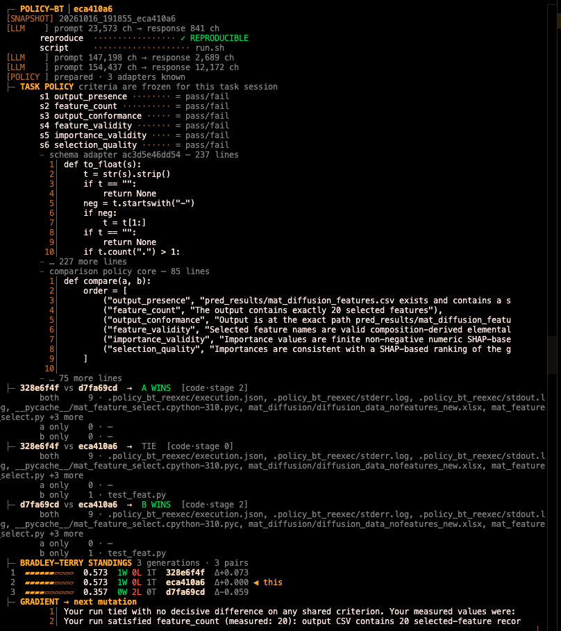
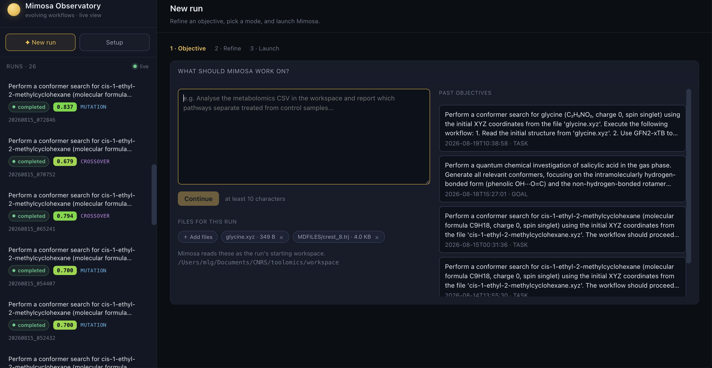
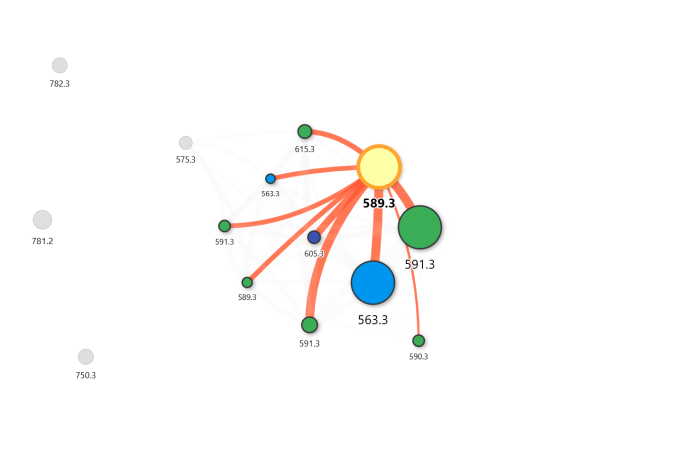

<p align="center">
  
</p>

<h1 align="center">Mimosa-AI</h1>

<p align="center"><strong>Build, run, check, and improve AI workflows for scientific research.</strong></p>

<p align="center">
  From <a href="https://holobiomicslab.cnrs.fr/">Holobiomics Lab, CNRS</a> · Open source · Apache 2.0
</p>

<p align="center">
  <a href="https://arxiv.org/abs/2603.28986"></a>
  <a href="https://opensource.org/licenses/Apache-2.0"></a>
</p>

<p align="center">
  <a href="#start-here">Start here</a> ·
  <a href="#how-mimosa-works">How it works</a> ·
  <a href="#see-policy-bt-in-the-terminal">Policy-BT</a> ·
  <a href="./docs/index.md">Documentation</a> ·
  <a href="#cite-this-work">Cite this work</a>
</p>

<p align="center">
  English · <a href="./README.CHS.md">简体中文</a> ·
  <a href="./README.CHT.md">繁體中文</a> ·
  <a href="./README.JPN.md">日本語</a> ·
  <a href="./README.KOR.md">한국어</a>
</p>

## What is Mimosa?

**Give Mimosa a scientific task. It writes a Python workflow for that task.**
The workflow uses AI agents and tools to produce results.
Mimosa checks the output files. With learning enabled, it uses the feedback to change the workflow and try again.

You do not have to define one fixed team of agents for all tasks.
Mimosa can change the agents, their instructions, and the steps they follow.

- **Use scientific tools.** Connect tools through the Model Context Protocol (MCP).
- **Inspect the code.** Each workflow is a Python program, not a hidden sequence of steps.
- **Compare the results.** The Policy-BT verifier compares outputs from different workflow versions.
- **Follow each change.** Saved code, prompts, logs, and parent records show how a workflow changed.

> **Research software, not proof of correctness.** A high verifier score does not prove that a scientific result is correct.
> Review the outputs before you use them.

## How Mimosa works

A **generation** is one version of a workflow and the results from its run.

1. **Set the task.** Describe the inputs, required outputs, and constraints. Use `--goal` to split a larger objective into tasks.
2. **Build the workflow.** Mimosa finds available tools and writes a Python program with AI agents.
3. **Run the workflow.** The agents use the tools and save output files in the workspace.
4. **Check the results.** Policy-BT checks reproduction and compares the generation with earlier generations for the same task.
5. **Improve the workflow.** With `--learn`, Mimosa uses the feedback to change the code or combine two earlier workflows.

The search keeps workflows for both result quality and code diversity.
This method is inspired by **Quality-Diversity search**: keep different approaches, not only small changes to one approach.

Read more about the [architecture](./docs/concepts/architecture.md) and the [evolution loop](./docs/concepts/evolution-engine.md).

## See Policy-BT in the terminal

The command-line interface (CLI) shows each check as the run proceeds.
Color, section labels, and score bars separate the comparison rules, pair results, ratings, and feedback.

<p align="center">
  <a href="./docs/images/policy-bt.png"></a>
</p>

<p align="center"><em>One task, three generations, and three pair comparisons. Select the image to see the details.</em></p>

### What the verifier checks

**Policy** means the shared rules used to compare results.
**BT** means Bradley–Terry, the statistical model that converts pair results into ratings.

1. **Check reproduction.** Each generation must supply a shell script that installs its requirements and recreates its outputs.
   A missing or invalid script gives a score of zero. By default, the verifier runs the script again in a fresh Python environment.
2. **Set common rules.** An AI model reads the task and inspects the files.
   It defines comparison criteria. Adapters read different file formats into a common form.
3. **Compare each pair.** One shared Python policy applies the rules to both generations.
   The verifier checks both comparison orders. Relevant images can resolve a code tie when both sides have images.
4. **Update the ratings.** Bradley–Terry uses the pair results to update every generation's rating for the task.
   Feedback tells the next workflow what needs to improve.

**A rating is relative to the other generations. It is not a benchmark success rate.**
The default verifier is `policy_bt`. See the [verification guide](./docs/concepts/evaluation-pipeline.md) for the full procedure.

## Start here

### 1. Install Mimosa

You need **Python 3.11 or 3.12**, [uv](https://docs.astral.sh/uv/), and API access to the models you select.
Model calls can incur charges.

```bash
git clone https://github.com/HolobiomicsLab/Mimosa-AI.git
cd Mimosa-AI
uv sync
```

<details>
<summary>Other installation methods</summary>

**Install the standalone command:**

```bash
uv tool install git+https://github.com/HolobiomicsLab/Mimosa-AI.git
mimosa
```

For this installation, put API keys in `~/.config/mimosa/.env`.
The setup wizard saves settings in `~/.config/mimosa/config.json`.
Run files are stored in `~/.local/share/mimosa/`.

**Use the automatic installer:**

The installer also sets up the Toolomics and Perspicacité companion projects.
[Read the script](./auto-install.sh) before you run it. It installs software and starts services.

```bash
curl -fsSL https://raw.githubusercontent.com/HolobiomicsLab/Mimosa-AI/refs/heads/mimosa_v2/auto-install.sh -o auto-install.sh
bash auto-install.sh
```

</details>

### 2. Connect models and tools

Create a `.env` file in the project root. Add the keys for your model providers.
For example, use this entry for OpenRouter models:

```dotenv
OPENROUTER_API_KEY=your_api_key
```

Do not share this file or commit it to Git.
See [API keys](./docs/getting-started/env.md) for other providers.

Start [Toolomics](https://github.com/HolobiomicsLab/toolomics) to provide scientific tools and a shared workspace.
You can also use [your own MCP servers](./docs/concepts/tools-and-mcp.md#operating-without-toolomics).
Toolomics is not required if your servers provide the tools that the task needs.

Copy the example configuration:

```bash
cp config_default.json my_config.json
```

Edit `my_config.json`:

- Set `workspace_dir` to the workspace that your tools use.
- Set `discovery_addresses` to your trusted MCP server addresses and ports.
- Select models for workflow generation, agents, planning, and verification. Check that you have the required provider keys.

[Perspicacité](https://github.com/HolobiomicsLab/Perspicacite-AI) is an optional service for literature support.
See the [configuration guide](./docs/getting-started/configuration.md) for more details.

### 3. Run a task

Put the input files in the shared workspace. Then describe a task that your tools can perform:

```bash
uv run main.py --config my_config.json \
  --task "Read measurements.csv. Save a summary table and a plot for each numeric column." \
  --learn
```

Use `--learn` to enable repeated workflow changes. Omit it for one workflow run.
Use `--goal` instead of `--task` when you want the planner to split a larger objective into tasks.

For guided setup, run `uv run main.py` without arguments.
See the [quickstart](./docs/getting-started/quickstart.md) for more examples.

### 4. Inspect the results

In a repository checkout:

- `sources/workflows/` contains generated code, prompts, logs, and verifier feedback.
- `runs_capsule/` contains saved result workspaces.
- `run_notes/` contains campaign records for benchmark runs.

The [workspace guide](./docs/usage/workspace.md) and [trace guide](./docs/usage/transparency.md) explain how to inspect these files.

> **Use a controlled environment.** Generated code and tool calls can change files.
> The workflow runner has restrictions, but verifier reproduction scripts run as host processes, not in an operating-system sandbox.
> Use trusted tools and a separate workspace. Do not give runs access to sensitive data.

## Inspect runs in the web interface

**Observatory** is the optional local web interface.
Use it to set up runs, view workflow history, and inspect output files.

```bash
cd webui
./deploy.sh
```

Open <http://localhost:5173/> after the services start.

<p align="center">
  <a href="./docs/images/interface.png"></a>
</p>

> **Local use only.** Observatory has no authentication. Do not expose it on a shared or public network.

See the [Observatory guide](./webui/README.md) for requirements and settings.

## A possible future: the autonomous laboratory

<p align="center">
  <a href="./docs/images/mimosa_illustration.png"></a>
</p>

<p align="center"><em>A hypothetical use of Mimosa. This image does not show a deployed laboratory or a current robot-control feature.</em></p>

Mimosa currently builds and improves software workflows.
With suitable instrument interfaces, a future system could connect those workflows to laboratory equipment.
It could use measurements to compare methods and propose the next experiment.

**That use would need separate engineering and safety checks.**
Instrument control, human approval, and physical safety systems would be required.
The illustration shows a research direction, not a claim that Mimosa provides these systems today.

## Research results

### V1 benchmark

The following results are from **V1**, on 102 ScienceAgentBench tasks with DeepSeek-V3.2 agents.
They do not measure the current V2 Policy-BT verifier.

| Mode | Task success rate | CodeBERT score (CBS) | Cost per task |
| --- | ---: | ---: | ---: |
| Single agent | 38.2% | 0.898 | $0.05 |
| Multi-agent, one run | 32.4% | 0.794 | $0.38 |
| Multi-agent, repeated improvement | **43.1%** | **0.921** | **$1.70** |

CBS measures code similarity. It is separate from task success.
The V1 setup used Opus 4.5 for workflow generation and changes. Costs depend on the selected models and number of runs.
See the [paper](https://arxiv.org/abs/2603.28986) for methods and limitations.

**V2 evaluation is in progress.**

### V1 example: molecular networking

This earlier demonstration shows a molecular-networking workflow for LC-MS/MS data.
It covers the networking step, not the full experimental procedure from [Nothias et al. (2018)](https://www.researchgate.net/publication/323525305_Bioactivity-Based_Molecular_Networking_for_the_Discovery_of_Drug_Leads_in_Natural_Product_Bioassay-Guided_Fractionation).

[Watch the V1 demonstration](https://github.com/user-attachments/assets/dcd04ade-9c43-44a8-b3e3-a999d3dc895d).

<details>
<summary>View the molecular network</summary>

<p align="center">
  
</p>

The workflow produced a GraphML network for Cytoscape and a feature table.
The demonstration does not cover physical fractionation or manual annotation review.

</details>

## Documentation and contributions

- **Use Mimosa:** [Quickstart](./docs/getting-started/quickstart.md) · [Run modes](./docs/usage/modes.md) · [Configuration](./docs/reference/configuration.md)
- **Understand the system:** [Architecture](./docs/concepts/architecture.md) · [Workflow search](./docs/concepts/evolution-engine.md) · [Verification](./docs/concepts/evaluation-pipeline.md)
- **Run evaluations:** [ScienceAgentBench](./docs/science_agent_bench_evaluation.md) · [PaperBench](./docs/papers_bench_evaluation.md)
- **Monitor runs:** [Notifications](./docs/usage/notifications.md) · [Telemetry](./docs/usage/telemetry.md)
- **Contribute:** [Contribution guide](./CONTRIBUTING.md) · [Developer guide](./docs/DEVELOPER_GUIDE.md) · [Contribution terms](./CLA/)

To view the documentation locally:

```bash
uvx --with mkdocs-material mkdocs serve
```

Related research includes [AI Scientist](https://github.com/SakanaAI/AI-Scientist), [DiscoPOP](https://github.com/SakanaAI/DiscoPOP), [FunSearch](https://github.com/google-deepmind/funsearch), and [OpenELM](https://github.com/CarperAI/OpenELM).
See the paper for a comparison with these systems.

Mimosa-AI uses the **Apache 2.0** license.
See [NOTICE](./NOTICE) and the [license notes](./docs/licensing-notes.md).

## Cite this work

[Mimosa Framework: Toward Evolving Multi-Agent Systems for Scientific Research](https://arxiv.org/abs/2603.28986), 2026.
[DOI: 10.48550/arXiv.2603.28986](https://doi.org/10.48550/arXiv.2603.28986).

```bibtex
@article{legrand2026mimosa,
  title         = {Mimosa Framework: Toward Evolving Multi-Agent Systems for Scientific Research},
  author        = {Legrand, Martin and Jiang, Tao and Feraud, Matthieu and Navet, Benjamin
                   and Taghzouti, Yousouf and Gandon, Fabien and Dumont, Elise and Nothias, Louis-F{\'e}lix},
  journal       = {arXiv preprint arXiv:2603.28986},
  year          = {2026},
  eprint        = {2603.28986},
  archivePrefix = {arXiv},
  primaryClass  = {cs.AI}
}
```
