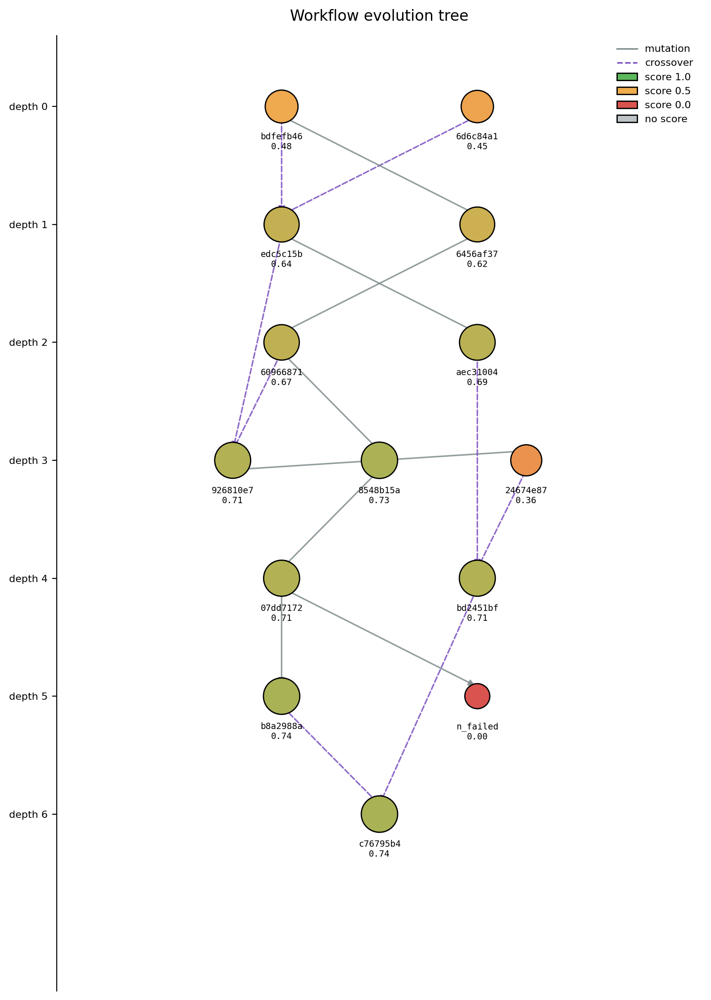

# Iterative learning

Run any task with `--learn` and Mimosa retries it across generations,
keeping only improvements. This page covers the practical side; for the
mechanics, see [Evolution engine](../concepts/evolution-engine.md).

## Why learn first

Single-shot multi-agent workflows are noisy: even strong LLMs produce
workflows that need refinement. Iterative learning lets Mimosa explore the
workflow space, archive what worked, and recombine.

In practice:

- **Cold tasks** (no related runs on disk) benefit most — the first
  generation is often weak; iteration finds the strong region.
- **Warm tasks** (similar runs already on disk) start from a stronger
  baseline thanks to the disk-similarity scan.
- **Familiar tasks** (similar runs already on disk) can have a stored workflow
  reused by the selector — see [Workspace & audit trail](workspace.md).

## How to enable it

Add `--learn` to a task or goal mode invocation:

```bash
uv run main.py --task "Train a multitask model on the Clintox dataset…" \
              --learn \
              --config my_config.json
```

Or, for batch evaluations:

```bash
uv run main.py --science_agent_bench --csv_runs_limit 20 --learn
```

Without `--learn`, the engine still runs the verifier but never iterates
— you get a one-shot result.

## Termination

Mimosa stops when any of these applies:

- `iteration >= max_learning_evolve_iterations` (config field, default `16`). This hard cap is checked first.
- Early stop, only after `min_learning_evolve_iterations` (default `6`) generations. `early_stop_mode` (default `auto`) selects plateau mode for relative verifiers (`policy_bt`, `hybrid`) and threshold mode for absolute verifiers (`legacy`, `gold`, scenario).

At termination the engine selects the best run and restores its workspace
with `WorkspaceManager.restore_best()`.

!!! tip "Tuning the stop rule"
    - The default `policy_bt` verifier is relative, so `early_stop_mode="auto"` uses plateau mode: the run stops after `plateau_patience` (default `3`) generations without a new champion.
    - `learned_score_threshold` (default `0.9`) applies only in threshold mode, which `auto` selects for absolute verifiers (`legacy`, `gold`, scenario).
    - Raising `plateau_patience` lets the loop explore longer; lowering it stops sooner after a stall.

## What evolves between generations

Mutation magnitude is **directive-implicit**: there is no step-size
controller. Each mutation assembles a deterministic, read-only
`<search_state>` block — parent score, iteration progress, a plateau
counter (`iters_since_improvement / 6`) over recent scored offspring,
the success rate of the last 5 scored offspring, and a short
score-only trajectory — and the directive LLM judges how bold the next
change should be (small tweak vs component rewrite vs structural
redesign) from those facts: recent improvements call for small tweaks,
a long plateau or a 0 % success rate calls for bolder restructuring.
Hard guardrails stay in code: the mutation agent budget is sampled
parent-centered — within ±1 agent of the parent's count, hard-capped
at `[1, 7]` — at most one agent may be added or removed per mutation,
and 90 % of the previous workflow must stay unchanged.

By default `~40 %` of generations do **crossover** instead of mutation
(`crossover_rate = 0.4`) — two parents combined, best-parent-first, with
the offspring hard-capped at the highest parent agent count.

## What you'll see on disk

After a `--learn` run, each generation has its own folder under
`sources/workflows/<uuid>/`. Across the run you'll also get:

- `sources/workflows/<uuid>/reward_progress.png` — score-over-iteration curve.
- `sources/workflows/<uuid>/evolution_tree.png` — lineage tree (each
  node a workflow, edges showing mutation/crossover).
- `runs_capsule/<capsule_name>/` — copy of the workspace contents, written at the end of a `--goal` run.

{ width="60%" }

## Mid-run interruption

`SIGINT` (Ctrl-C) and `SIGTERM` are caught by `setup_signal_handlers()` in
`main.py`. Mimosa cancels in-flight async tasks and exits cleanly. The
session archive lives only in memory, so an interrupted `--learn` run
discards uncommitted progress — but every completed generation is already
on disk under `sources/workflows/<uuid>/` and can be inspected.

## See also

- [Evolution engine](../concepts/evolution-engine.md) — mechanics of QD selection.
- [Evaluation pipeline](../concepts/evaluation-pipeline.md) — what the scores mean.
- [Workspace & audit trail](workspace.md) — where each generation's artefacts go.
- [Transparency & replay](transparency.md) — step through any generation interactively.
